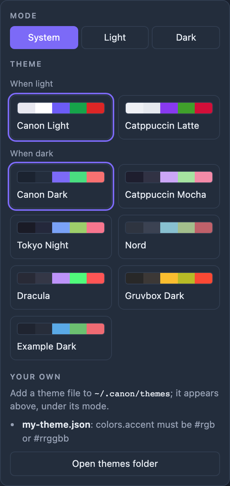

# Themes

The Cockpit's **◐ Theme** menu, at the bottom of its sidebar, sets the look of the Cockpit and every open board. Pick a
mode (System follows your computer's light or dark setting) and a theme for it. canon ships eight themes; you can add
your own.

## Default themes

| Theme | Mode | Project | Licence |
|---|---|---|---|
| Canon Light | light | canon's own colours | MIT, Copyright (c) 2026 Sunit Joshi |
| Canon Dark | dark | canon's own colours | MIT, Copyright (c) 2026 Sunit Joshi |
| Catppuccin Latte | light | [Catppuccin](https://github.com/catppuccin/palette) (`palette.json`) | MIT, Copyright (c) 2021 Catppuccin |
| Catppuccin Mocha | dark | [Catppuccin](https://github.com/catppuccin/palette) (`palette.json`) | MIT, Copyright (c) 2021 Catppuccin |
| Tokyo Night | dark | [Tokyo Night](https://github.com/enkia/tokyo-night-vscode-theme) by enkia (the README's palette) | MIT, Copyright (c) 2018-present Enkia |
| Nord | dark | [Nord](https://www.nordtheme.com/docs/colors-and-palettes) (nord0–nord15) | MIT, Copyright (c) 2016-present Sven Greb |
| Dracula | dark | [Dracula](https://draculatheme.com/spec) (the Dracula specification) | MIT, Copyright (c) 2023 Dracula Theme |
| Gruvbox Dark | dark | [Gruvbox](https://github.com/morhetz/gruvbox) by Pavel Pertsev (morhetz) (`colors/gruvbox.vim`) | MIT/X11 (README and `package.json`; the repository has no LICENSE file) |

Each third-party theme uses only colours from that project's own published palette, mapped onto canon's 12 colour slots
(`tools/sprint-check-app/static/theme-data.js`). canon credits each project above; their palettes are used under the
licences named, and canon does not include their code.

## Readability

Every theme, Canon included, is held to WCAG AA: at least 4.5:1 for text on the background and for muted text on
panels, and at least 3:1 for the accent on the background and for text on the accent (AA for large text and UI parts;
Canon's own accent is 3.96:1 dark and 3.82:1 light). Where a project's natural colour for a slot fell short, canon uses
another colour from the same palette rather than inventing one:

- **Catppuccin Latte:** muted text is Subtext1 (Subtext0 reads 4.06:1 on Mantle), and the panels are Mantle on a Base
  background.
- **Gruvbox Dark:** muted text is light3 (light4 reads 4.17:1 on dark1).
- **Nord:** the three text levels are nord6, nord5 and nord4 (nord3, Nord's comment colour, is too dim for text).
- **Dracula:** Dracula has one foreground colour, so body text is Foreground too, and muted text is Cyan (Comment reads
  below 3:1 on Dracula's panels).

`tests/sprint-check-theme.js` checks every pair above for every theme.

## Your own themes

Drop a theme file in `~/.canon/themes/` and it appears in the menu under its mode. The format, the rules and how a
refused file is reported: [Custom themes](docs/custom-themes.md).
